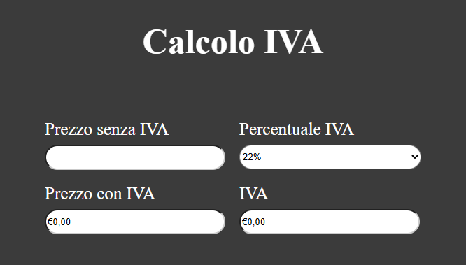

# Calcolatore IVA

## Descrizione

Un semplice calcolatore d'IVA che permette di calcolare, partendo da un valore in € senza IVA, il prezzo con IVA inclusa e anche solo l'IVA, in tempo reale, senza dover premere un tasto "Calcola".  

Il tutto calcolato in base all'IVA scelta dall'apposito menù a tendina.  
Non è modificabile perchè ho già inserito le principali aliquote:

L'aliquota ordinaria del 22% che si applica alla maggior parte di beni e servizi, mentre le altre 3 sono aliquote ridotte stabilite dal DPR 633/1972 per specifiche categorie.
